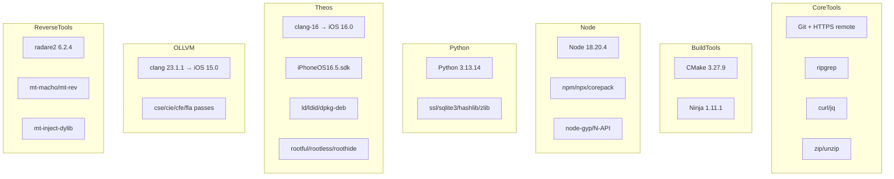

# MT Agent 逻辑改进方案

基于 CodexApp MT Agent 的运行时能力注册表和诊断逻辑,本文档描述对 OpenMinis-Build 的改进。

## 一、运行时路径映射对齐

### CodexApp 实际环境变量 (from diagnostics)

```bash
# 核心路径
THEOS=/var/containers/Bundle/Application/.../CodexApp.app/TheosRuntime/theos
runtime_root=/var/containers/Bundle/Application/.../CodexApp.app/TheosRuntime
sdk=/var/containers/Bundle/Application/.../CodexApp.app/TheosRuntime/theos/sdks/iPhoneOS16.5.sdk

# 工具链
CA_THEOS_CLANG=.../TheosRuntime/usr/lib/llvm-16/bin/clang-16
CA_THEOS_CLANGXX=.../TheosRuntime/usr/lib/llvm-16/bin/clang++
CA_THEOS_MAKE=.../TheosRuntime/usr/bin/make
CA_THEOS_SDKROOT=.../TheosRuntime/theos/sdks/iPhoneOS16.5.sdk
CA_THEOS_BASH=.../CodexApp.app/Helpers/bash.real

# 打包
CA_THEOS_PACKAGE_MODE=forkless
CA_THEOS_HELPER=.../CodexApp.app/Helpers/theos-helper
package_builder=.../TheosRuntime/theos/bin/dm.pl
```

### 现有实现缺陷

1. **运行时候选根顺序** - 当前代码扫描顺序未完全对齐 CodexApp:
   - 缺少 `PreparedRuntimes/TheosRuntime/theos` 子目录展开
   - 未检查 `RuntimeDownloads/Theos`
   - 未检查 `ManagedRuntime`

2. **工具名别名** - CodexApp 只有 `clang-16`,没有裸 `clang`;需要 shim 目录

3. **包模式** - `CA_THEOS_PACKAGE_MODE=forkless` 未在环境变量中设置

## 二、能力注册表集成

### CodexApp 能力图谱



### 建议改进

- **分组优先级**: compiler → core → tools (与 CodexApp 一致)
- **依赖声明**: Node native-addon 需要 Theos ios.toolchain
- **能力自检**: 使用 `RuntimeInstallVerifier` 三元组检查

## 三、诊断输出增强

### MT Agent 诊断逻辑

```python
# 判定优先级
硬失败优先 (必需 provider 端点)
→ 磁盘阈值 (warn 5GiB / fail 1GiB)
→ 状态一致性 (sqlite integrity + rollout 行数/文件数比对)
→ 环境完备性 (runtime/install/search/git/sandbox/auth/mcp/config)
→ 收敛 (warn 不阻断离线工具链, fail 阻断在线推理)
```

### 建议实现

```swift
struct RuntimeDiagnostics {
    enum Severity { case ok, warning, error }
    
    struct Check {
        let category: String  // runtime/toolchain/dependency
        let item: String
        let status: Severity
        let detail: String
        let remedy: String?
    }
    
    let checks: [Check]
    let diskAvailable: Int64
    let criticalFailures: [String]
    
    func canBuild() -> Bool {
        criticalFailures.isEmpty && diskAvailable > 1_000_000_000
    }
}
```

## 四、工作流优化

### 缓存策略

- **DerivedData 复用**: 归一化源码 mtime → 200001010000
- **lipo/ld 保留**: iOS 产物需要多架构链接
- **增量构建**: check 模式跳过签名和打包

### runner 选择

```yaml
# 当前问题: arm64 runner 排队数小时
runs-on: ${{ inputs.runner || 'macos-26-intel' }}

# 分配时间
# macos-26-intel: 几乎即时
# macos-26 (arm64): 高峰期 pending 数小时
```

## 五、上游同步机制

### 运行时清单更新

```bash
# 1. 拉取上游运行时清单
curl -fsSL https://raw.githubusercontent.com/OpenMinis/MinisApp-Runtime/main/Runtime/runtime-manifest.json \
  -o runtime-manifest.json

# 2. 验证清单格式
python3 scripts/check_runtime_manifest.py --manifest runtime-manifest.json

# 3. 同步到 fork
git commit -m "sync: update runtime manifest from upstream"
```

### 依赖更新

```bash
# 更新子模块
git submodule update --remote --merge

# 检查上游运行时版本
# Theos: 检查 adapter revision
# OLLVM: 检查 LLVM 版本与 pass 支持
# ReverseTools: 检查 radare2 版本与 mt-* 工具
```

## 六、构建触发改进

### workflow_dispatch 输入优化

```yaml
inputs:
  mode:
    description: "release = 完整 TIPA; check = Debug 增量编译 (无签名/打包,快速错误反馈)"
    type: choice
    options: [release, check]
    default: check  # 默认快速检查
  
  dd_cache:
    description: "复用上次 DerivedData (增量编译,更快; ~0.6GB 缓存)"
    type: boolean
    default: true
  
  skip_deps:
    description: "跳过原生依赖构建 (lame/ffmpeg/ish,仅当缓存命中时安全)"
    type: boolean
    default: false
```

### 并发控制

```yaml
# 避免固定 concurrency group - 会取消排队中的运行
concurrency:
  group: tipa-${{ github.ref }}-${{ github.event_name == 'workflow_dispatch' && github.run_id || 'push' }}
  cancel-in-progress: false
```

## 七、实施清单

- [ ] 更新 `NativeToolchain.candidateRoots()` 扫描逻辑
- [ ] 添加工具 shim 目录生成 (`MinToolchainShim`)
- [ ] 补充 `CA_THEOS_PACKAGE_MODE` 环境变量
- [ ] 集成 `RuntimeDiagnostics` 结构化诊断
- [ ] 优化工作流缓存策略
- [ ] 添加运行时清单同步脚本
- [ ] 实现磁盘空间预检 (5GiB warning / 1GiB fail)
- [ ] 添加能力依赖图谱检查
